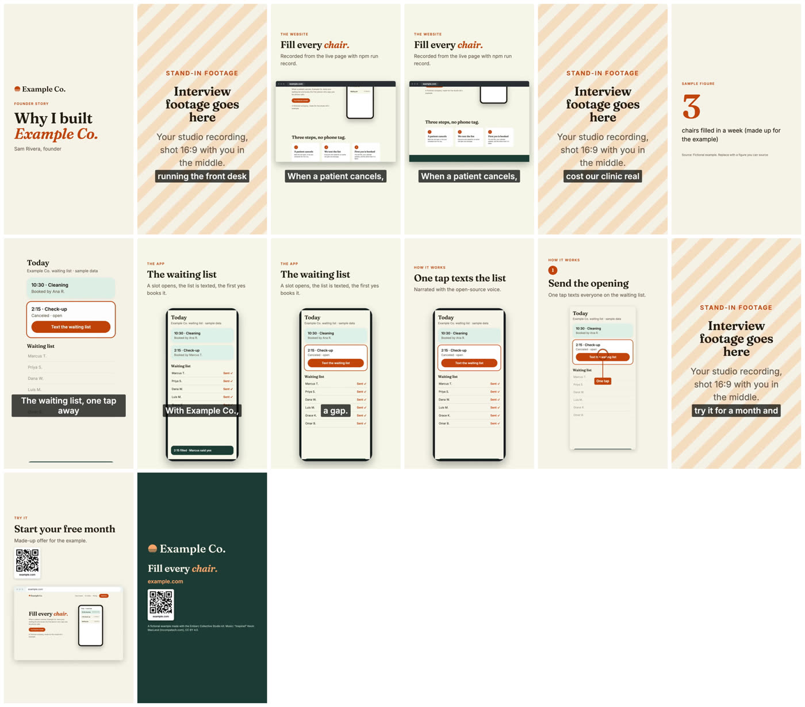

# Embarc Collective Studio kit

Turn one studio session into a month of content for your company. Record a podcast-style conversation about who
you are and what you are building; an AI agent then cuts it into a founder video and short clips, splices in your
product walkthroughs, screenshots, and figures, adds captions, a voiceover, and music, and makes the posts and
one-pagers to go with them, all in your brand.

Every engine is open source and runs on your own computer. Nothing is uploaded.

*The example project, one frame per scene: a fictional founder of a fictional company, cut to 65 seconds. Interview
soundbites with captions and a lower third; the company's website scrolling in a browser frame and its app running
in a phone frame, over the founder's voice; a screenshot, a figure with its source, a how-to step, the website with a
QR code, and the close. Watch it: [9:16](docs/example-9x16.mp4) · [16:9](docs/example-16x9.mp4). Make it yourself
with `npm run example`.*

## What is in it

| Engine | What it does |
|---|---|
| **Interview** | Eighteen seeded questions in six parts (who you are, what you build, why, who it is for, why they should care, closing), a run of show for the studio, and a transcriber that turns the recording into numbered sentences with times |
| **Cut** | The editor. You (or your agent) list the soundbites by sentence, and it splices them with website and app recordings, screenshots, photos, and cards for titles, figures, and quotes, laying the product over the founder's voice. Stills move slowly, cards land on the beat, captions and a lower third are drawn in your brand, the music ducks under speech, and the mix lands at -14 LUFS, in 9:16 and 16:9 |
| **Screen** | Records your website scrolling, or your app as it runs, desktop or phone, with no screen-recording software; screenshots too. The editor plays them in browser and phone frames among your soundbites and stills |
| **Cards** | Title, figure, quote, how-to step with callouts, your website with a QR code, caption, lower third, and end cards, drawn in your brand |
| **Voice** | An open-source narrator (Kokoro-82M) for product videos, every take checked against its script |
| **Reel** and **Tour** | A vertical video recorded from your live site, and a narrated Demo button for it, from [history-of-block-printing](https://github.com/fritzhand/history-of-block-printing) |
| **Collateral** | Posts, slides, flyers, and one-pagers in five formats, from the [collateral builder](https://github.com/fritzhand/collateral-builder), sharing the same brand folder |

## Start

1. **Get a copy** and open the folder in Claude Code, Codex, Cursor, or any agent that works on a folder. The agent
   reads [`AGENTS.md`](AGENTS.md) and knows how the kit works.
2. **Install the tools:** Node 22+, ffmpeg, Python 3 with numpy, Google Chrome, and whisper.cpp with a model
   ([`engines/interview/README.md`](engines/interview/README.md)). Kokoro is optional
   ([`engines/voice/README.md`](engines/voice/README.md)). Then `npm run doctor`.
3. **See it work:** `npm run example` (add `-- --engine say` on a Mac without Kokoro).
4. **Add your brand:** a folder in `brands/` ([`brands/README.md`](brands/README.md)).
5. **Record** the seeded interview ([`engines/interview/QUESTIONS.md`](engines/interview/QUESTIONS.md)) and start a
   project: `npm run new -- your-company --brand your-brand`.
6. **Ask your agent**, for example:
   > Transcribe projects/your-company/footage/interview.mp4 and record our website, yourcompany.com. Then cut a
   > 60-second founder story in 9:16: who I am, what we build, why, who it's for, and why they should care. Show the
   > website in a browser frame whenever I describe the product, and the screen recording in footage/ in a phone
   > frame. Use only my exact words and no figures I didn't give you. Show me the contact sheet.

## What it needs

| Tool | For |
|---|---|
| Node 22+ | the scripts |
| ffmpeg | every video and sound step |
| Python 3 with numpy | the cut engine |
| Google Chrome or Chromium | drawing cards and captions (headless) |
| whisper.cpp and a model | transcripts, and checking voice takes |
| Kokoro-82M (optional) | the open-source voiceover |

## License

MIT for this repo's code ([`LICENSE`](LICENSE)). The voice pipeline's `speak.py` and `voice-script.mjs` come from
history-of-block-printing (CC0). The example brand and its fonts come from the collateral builder (MIT; the fonts
are SIL Open Font License, licenses in `brands/example-co/assets/fonts/`). Music is downloaded, not included; each
track's license is in [`music/README.md`](music/README.md).
